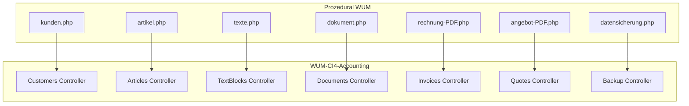
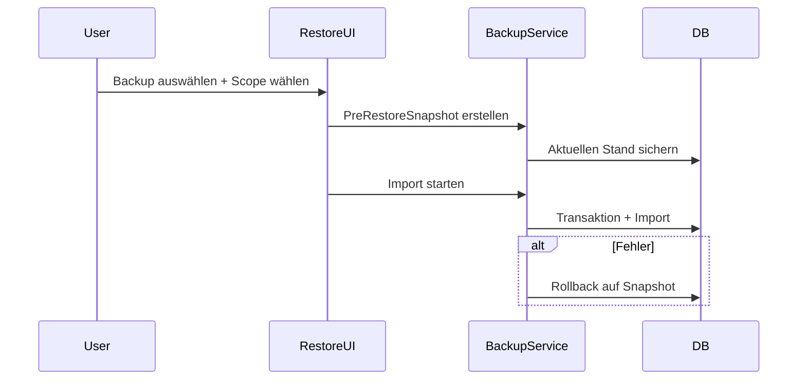

# WUM → WUM-CI4-Accounting: Migrationsplan

## Kurzantwort: Ist die Migration möglich?

**Ja.** Das Original ist ein überschaubares prozedurales PHP-Projekt mit 7 Datenbanktabellen, flachen Root-Skripten und wiederverwendbarer Logik in [`c:\UniServerZ\www\wum\inc\`](c:\UniServerZ\www\wum\inc\). Das CI4-Zielprojekt [`c:\UniServerZ\www\wum-ci4-accounting`](c:\UniServerZ\www\wum-ci4-accounting) hat bereits:

- Login/Session ([`app/Controllers/Login.php`](app/Controllers/Login.php))
- Benutzerverwaltung ([`app/Controllers/UserManagement.php`](app/Controllers/UserManagement.php), Tabelle `user`)
- Layout-Template-Pattern ([`app/Views/layout.php`](app/Views/layout.php) mit `extend`/`section`)
- Bootstrap 5 + Font Awesome in `public/assets/`

Fehlend und zu migrieren: Stammdaten-CRUD, Dokument-Wizard, Rechnungs-/Angebots-PDF, E-Mail-Versand, Datensicherung/Wiederherstellung.



---

## Scope (laut Vorgabe)

| Original | CI4-Modul | Status |
|----------|-----------|--------|
| `kunden.php` | Customers | migrieren |
| `artikel.php` | Articles | migrieren |
| `texte.php` | TextBlocks | migrieren |
| `dokument.php` | Documents (Wizard) | migrieren |
| `rechnung-PDF.php` | Invoices (PDF + Buchung) | migrieren |
| `angebot-PDF.php` | Quotes (PDF + Buchung) | migrieren |
| `settings.php` | UserManagement (bereits vorhanden) | erweitern falls nötig |
| `datensicherung.php` + Worker | Backup | migrieren |
| `wiederherstellung.php` | Restore (neu konzipiert) | migrieren + verbessern |
| `ansicht.php` | — | **ausgeschlossen** (nur Anzeige) |
| `steuerberater`-Feld in `rechnungen` | — | **entfällt** |
| `update.php`, Adminer | — | **ausgeschlossen** |

---

## Englisches Datenbankschema (optimiert)

Bestehende Tabelle `user` bleibt; neue Tabellen per CI4-Migrations in [`app/Database/Migrations/`](app/Database/Migrations/).

| Alt (DE) | Neu (EN) | Wichtige Feldumbenennung |
|----------|----------|--------------------------|
| `benutzer` | `user` | bereits vorhanden: `username`, `first_name`, `last_name`, `password`, `rights` |
| `kunden` | `customers` | `customer_number`, `company`, `first_name`, `last_name`, `street`, `postal_code`, `city`, `phone`, `email`, `note`, `status`, `meta` |
| `artikel` | `articles` | `article_number`, `title`, `price_cents`, `status`, `note`, `meta` |
| `texte` | `text_blocks` | `text_key` (z.B. `intro1`, `closing1`), `content`, `status`, `note`, `meta` |
| `rechnungen` | `invoices` | `invoice_number`, `amount_cents`, `invoice_date` (DATE statt `varchar`), `customer_number`, `customer_last_name`, `status`, `filename` — **ohne** `steuerberater` |
| `angebote` | `quotes` | `quote_number`, `amount_cents`, `quote_date`, `customer_number`, `company_name`, `status`, `filename` |
| `update` | optional `changelog` | nur falls später gewünscht; aktuell **nicht** im Scope |

**Schema-Verbesserungen gegenüber Original:**
- `utf8mb4` + sinnvolle `COMMENT`-Felder
- Geldbeträge einheitlich `amount_cents` / `price_cents` (INT)
- Datumsfelder als `DATE` oder `DATETIME` statt `varchar(16)`
- generisches `meta` statt unklarem `auswahl` (Version/Flags)
- `status` als dokumentierte Konstanten in Models (0=deleted, 1=active, 2=one-time)
- Indizes auf `invoice_number`, `quote_number`, `customer_number`

**Datenmigration:** Einmaliges Seed/Migration-Skript liest aus DB `wum` und schreibt in `wum-ci4-accounting` mit Feld-Mapping. User `wumy` bleibt; `benutzer`-Datensatz wird nur ergänzt, falls Felder fehlen (Passwort-Hash ist kompatibel).

---

## Modulstruktur in CI4

Jeder fachliche Bereich bekommt eigenen Controller, Model und View-Ordner:

```
app/
  Controllers/
    Customers.php, Articles.php, TextBlocks.php
    Documents.php, Invoices.php, Quotes.php
    Backup.php
  Models/
    CustomerModel.php, ArticleModel.php, TextBlockModel.php
    InvoiceModel.php, QuoteModel.php
  Views/
    Customers/, Articles/, TextBlocks/
    Documents/, Invoices/, Quotes/
    Backup/
  Libraries/
    TcpdfDocument.php      # MYPDF-Klasse aus rechnung-PDF.php / angebot-PDF.php
    DocumentMailer.php     # E-Mail-Versand
  Services/
    BackupService.php      # Job-Logik aus mgp_backup_* in funktionen.inc.php
    RestoreService.php     # neu: sichere Wiederherstellung
```

**Routes** in [`app/Config/Routes.php`](app/Config/Routes.php) z.B.:
- `/customers`, `/articles`, `/text-blocks`
- `/documents` (Wizard-Schritte 1–4)
- `/invoices/preview`, `/invoices/book`, `/quotes/preview`, `/quotes/book`
- `/backup`, `/backup/worker`, `/restore`

**Menü** in [`BaseController::getMenu()`](app/Controllers/BaseController.php) analog zum Original-Menü in [`wum/inc/hauptmenue.inc.php`](c:\UniServerZ\www\wum\inc\hauptmenue.inc.php): Home, Kunden, Artikel, Dokument, Verwaltung (Texte, Profil, Backup, Restore).

**Rechte:** CI4 nutzt bereits `registered` / `admin` / `superadmin`. Mapping vom Original (`fp23` → `superadmin`, `tz67` → `admin`, `we89` → `registered`) im Migrations-Skript.

**Code-Konvention:** PHP-Variablen, Methoden, DB-Spalten auf Englisch; UI-Texte weiter Deutsch (wie bisher); Kommentare DE/EN gemischt.

---

## Kernlogik pro Modul (Referenz Original)

### Stammdaten (Customers, Articles, TextBlocks)
- Logik aus [`kunden.php`](c:\UniServerZ\www\wum\kunden.php), [`artikel.php`](c:\UniServerZ\www\wum\artikel.php), [`texte.php`](c:\UniServerZ\www\wum\texte.php)
- Ersetzt generisches `DB_schreiben()` aus [`funktionen.inc.php`](c:\UniServerZ\www\wum\inc\funktionen.inc.php) durch CI4-Models mit Validation
- Soft-Delete über `status = 0` beibehalten

### Documents (Wizard)
- 4-Schritt-Session-Flow aus [`dokument.php`](c:\UniServerZ\www\wum\dokument.php) + Hilfen aus [`dokument-hilfen.inc.php`](c:\UniServerZ\www\wum\inc\dokument-hilfen.inc.php)
- Session-Keys englisch: `document_type`, `customer_number`, `line_items`, `text_keys`, `total_cents`
- Abschluss leitet zu Invoice- oder Quote-Preview weiter

### Invoices / Quotes (PDF)
- TCPDF-Klasse `MYPDF` / `MYPDFAngebot` aus [`rechnung-PDF.php`](c:\UniServerZ\www\wum\rechnung-PDF.php) und [`angebot-PDF.php`](c:\UniServerZ\www\wum\angebot-PDF.php) → `App\Libraries\TcpdfDocument`
- Nummernlogik (`neue_rechnungsnummer`, `neue_angebotsnummer`) → Service-Methoden
- PDF-Archiv: `writable/archives/invoices/` und `writable/archives/quotes/` (statt `archiv/rechnungen/`)
- „Buchen“ schreibt Datensatz + speichert PDF; optional E-Mail

### TCPDF-Integration
- Bestehende [`TCPDF-main/config/tcpdf_config.php`](c:\UniServerZ\www\wum\TCPDF-main\config\tcpdf_config.php) nach `app/ThirdParty/TCPDF/config/` kopieren und Pfade anpassen (`K_PATH_MAIN`, `K_PATH_URL`, Logo-Pfade)
- Alternativ: `composer require tecnickcom/tcpdf` + externe Config via `K_TCPDF_EXTERNAL_CONFIG`
- **Empfehlung:** Eigene Kopie in `app/ThirdParty/TCPDF` (versioniert, WUM-Layout bleibt), nicht in gitignored `vendor/`

---

## E-Mail: PHPMailer oder CI4?

**Antwort:** CI4 bringt eine eigene E-Mail-Klasse mit ([`app/Config/Email.php`](app/Config/Email.php)): SMTP, HTML, Anhänge, BCC sind möglich.

| Anforderung | CI4 Email | PHPMailer (Original) |
|-------------|-----------|----------------------|
| SMTP + TLS | ja | ja |
| PDF-Anhang | ja (`attach`) | ja |
| HTML-Body | ja | ja |
| BCC | ja | ja |
| Eingebettetes Logo (`cid:firmenlogo`) | **nein** (umständlich) | ja (`addEmbeddedImage`) |
| Lesebestätigung (Custom Header) | begrenzt | ja |
| Bewährte WUM-Vorlage | Anpassung nötig | 1:1 übernehmbar |

**Empfehlung:** `phpmailer/phpmailer` per Composer hinzufügen (wie in [`wum/composer.json`](c:\UniServerZ\www\wum\composer.json)) und in `App\Libraries\DocumentMailer` kapseln. SMTP-Zugangsdaten in `.env` (`email.SMTPHost`, `email.SMTPUser`, `email.SMTPPass`) — **nicht** hardcoded wie in [`email.php`](c:\UniServerZ\www\wum\email.php).

CI4-native E-Mail reicht nur, wenn das Logo als externe URL im HTML eingebunden wird statt CID.

---

## Backup & Restore (verbessert gegenüber Original)

Original: [`datensicherung.php`](c:\UniServerZ\www\wum\datensicherung.php) + AJAX-Worker mit `mgp_backup_*` in [`funktionen.inc.php`](c:\UniServerZ\www\wum\inc\funktionen.inc.php) (~250 Zeilen Job-Logik).

**Backup (Phase 1):**
- Vollbackup per `mysqldump` (oder PHP-Fallback) + ZIP nach `writable/backups/`
- Fortschrittsanzeige per AJAX wie im Original
- Liste verfügbarer Backups mit Datum/Größe

**Restore (Phase 2 – neu konzipiert, da Original ungetestet):**

Vor jeder Wiederherstellung **automatisch Sicherung des aktuellen Bestands** (Pre-Restore-Snapshot).

UI-Abfragen vor Restore:
1. **Welches Backup?** — Dropdown/Liste aus `writable/backups/`
2. **Was wiederherstellen?** — Optionen: einzelne Tabelle, alle Tabellen, nur Stammdaten, nur Rechnungen/Angebote
3. **Konfliktstrategie** — z.B. „Tabelle leeren und importieren“ vs. „nur fehlende Datensätze“ vs. Abbruch bei Konflikt
4. **PDF-Archiv** — optional: zugehörige PDF-Dateien aus Backup-ZIP mitkopieren oder nur DB

Technisch: `RestoreService` mit Transaktionen, Validierung der ZIP-Struktur, Rollback auf Pre-Restore-Snapshot bei Fehler.



---

## Technische Voraussetzungen / Infrastruktur

- `composer install` im CI4-Projekt (Framework fehlt aktuell in `vendor/`)
- `composer require phpmailer/phpmailer`
- `.env` aus [`env.txt`](env.txt) mit DB- und SMTP-Credentials
- PHP-Erweiterungen: `mysqli`, `zip`, `gd` (TCPDF), optional `exec` für `mysqldump`
- CSRF-Filter aktivieren in [`app/Config/Filters.php`](app/Config/Filters.php) für alle POST-Routen
- Globaler Auth-Filter statt manueller `logged_in`-Checks in jedem Controller

---

## Empfohlene Umsetzungsphasen

### Phase 1 – Fundament (1–2 Tage)
- Migrations für englisches Schema
- Datenimport-Skript `wum` → `wum-ci4-accounting`
- Auth-Filter, CSRF, `.env`
- Menü erweitern

### Phase 2 – Stammdaten (2–3 Tage)
- Customers, Articles, TextBlocks (CRUD + Views)
- Tests mit migrierten Daten

### Phase 3 – Dokumente & PDF (3–5 Tage)
- Documents-Wizard
- TCPDF-Library portieren
- Invoices + Quotes (Entwurf + Buchen + Archiv)

### Phase 4 – E-Mail (0,5–1 Tag)
- DocumentMailer mit PHPMailer
- Versand nach Buchung (optional per Checkbox)

### Phase 5 – Backup & Restore (2–3 Tage)
- BackupService + UI
- RestoreService mit Pre-Snapshot, Auswahl-UI, Konfliktbehandlung

**Gesamtaufwand:** ca. 9–14 Arbeitstage für vollständige Parität inkl. Datenmigration und verbessertem Restore.

---

## Risiken & Mitigation

| Risiko | Mitigation |
|--------|------------|
| Doppeltes Passwort-Hashing in UserModel | Nur Model-Hook ODER Controller-Hash, nicht beides |
| TCPDF-Pfade auf Windows/UniServer | Pfade in Config zentral, Tests auf lokalem Setup |
| `mysqldump` nicht verfügbar | PHP-Export-Fallback |
| Restore zerstört Daten | Pre-Restore-Snapshot + Transaktionen |
| Rechnungsnummern-Kollision bei Migration | Historische Nummern 1:1 übernehmen, Generator nur für neue |

---

## Fazit

Die Migration ist **sinnvoll und gut planbar**. CI4 reduziert technische Schuld (kein globales `DB_schreiben`, keine Session-`include`-Ketten), Bootstrap/FontAwesome sind bereits da, TCPDF und PHPMailer lassen sich gezielt einbinden. Das englische Schema verbessert Wartbarkeit; die UI kann deutsch bleiben. Der größte Aufwand liegt in PDF-Generierung und dem neu zu konzipierenden Restore — nicht in der Grundarchitektur.
